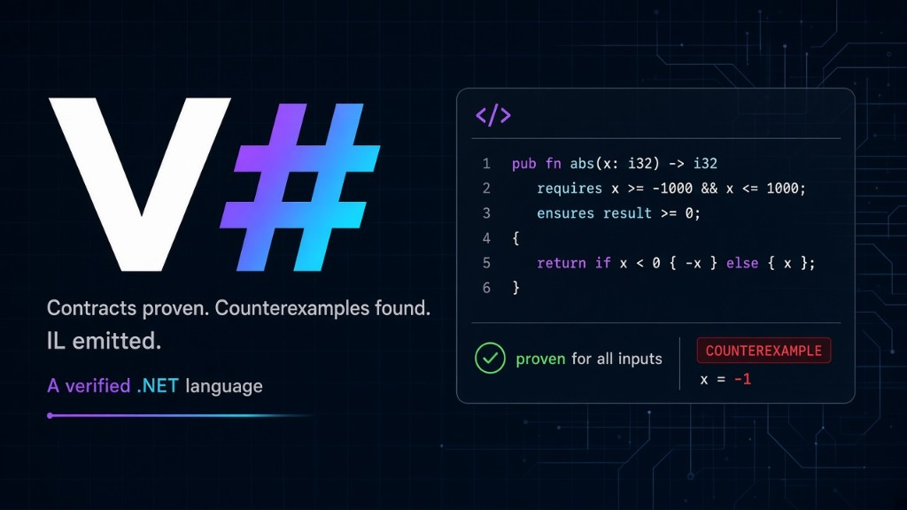

# V#



V# is a .NET language an agent can write, and a compiler that decides when the agent is done.

A person writes the contract. An agent writes the body. `vsharpc` proves the body meets the contract for every input, or returns the input that breaks it. A module that compiles is an ordinary .NET assembly. C# calls it like any other library.

In identifiers, where `#` is not allowed, the name is VSharp: `VSharp.Compiler`, `VSharp.Runtime`. Source files are `.vs`.

## The loop

This is the whole workflow.

1. **State the contract.** `requires` is what the caller must guarantee. `ensures` is what the function guarantees back. `result` names the return value. The contract is short, and it is the part worth a person's attention.
2. **Let the agent write the body.** It can leave `?name` where an expression is still missing. The compiler answers with the hole's type, the names in scope, the facts known there, and the obligations the expression must meet.
3. **Ask the compiler.** `vsharpc check --json` either accepts the module or returns a diagnostic: a stable code, a source span, a hint, and, when the solver found one, a counterexample.
4. **Repair from the counterexample.** The agent edits the body, or the contract if the contract was wrong, and checks again. Nothing unproved compiles, so "done" is a compiler result.

```
fn discounted(price: Decimal, percent: Decimal) -> Decimal
  requires price >= 0m
  ensures 0m <= result && result <= price
{
  return price - price * percent / 100m
}
```

```json
{
  "code": "TN3001",
  "message": "postcondition of 'discounted' might not hold: 0m <= result && result <= price",
  "status": "refuted",
  "counterexample": { "price": "1m", "percent": "101m", "result": "-0.01m" },
  "hint": "Either the code returns a wrong value on this path, or the 'ensures' clause is too strong. The counterexample gives concrete inputs."
}
```

A 101% discount makes the price negative. The fix is a precondition, `requires 0m <= percent && percent <= 100m`, which the verifier then demands of every caller. Changing a contract flags exactly the call sites that no longer hold. Changing a body re-proves only that function.

## What an agent needs in context

Verification is modular. A call is replaced by the callee's contract, so the callee's body is not part of the proof and does not need to be in the prompt.

| Command | What the agent gets |
|---|---|
| `vsharpc sig` | Every type, signature, and contract in the module, with no executable bodies. This is the context for writing a caller. |
| `vsharpc check --json` | `{ ok, verified, queries, output, diagnostics }`. Each diagnostic has `code`, `file`, `line`, `col`, `hint`, `status`, and `counterexample`. |
| `vsharpc explain TN3001` | What the code means and an example fix. `--json` returns the same as data. |
| `vsharpc fmt --check` | Fails unless the file is in the one canonical layout. `--write` rewrites it. A diff then contains only the real change. |

A typed hole is a question to the compiler:

```
fn max(a: Int, b: Int) -> Int
  ensures result >= a && result >= b
{
  return ?answer
}
```

```
error TN4001: hole ?answer has type Int
  in scope: a: Int, b: Int
  must satisfy: postcondition of 'max' might not hold: result >= a && result >= b
```

## Why generated code goes wrong less often

The syntax has one way to say each thing, chosen so a model has fewer silent mistakes available.

- **Every statement starts with a keyword** (`let`, `set`, `if`, `return`, `do`, …). There are no semicolons, and a broken line cannot swallow the next one.
- **Names are unique inside a function.** There is no shadowing, so a name means one thing everywhere it appears.
- **Arguments are named when two parameters share a type.** `discounted(price: p, percent: c)` cannot be written with the arguments swapped.
- **There is no null and no overloading.** Absence is `Option`, expected failure is `Result` or a `throws` clause, and `match` must cover every case.
- **Values do not change after they are built.** Only a local `var` is mutable, so a function cannot change data the caller still holds.
- **Effects are part of the signature.** A function that prints says `effects io`. A function that awaits says `effects async`. With no effects and no `throws`, a function is pure and may appear inside contracts.
- **Every loop and every recursion ends.** A `for` is bounded. A `while` or a recursive function states a `decreases` measure that shrinks. An agent cannot leave a hang for a test run to discover.
- **Overflow does not wrap.** `Int` arithmetic traps, or, in `total` mode, the compiler proves it cannot happen.

## Build and run

The compiler targets the .NET 10 SDK. Verification links Z3 4.12.2. The `Microsoft.Z3` package on NuGet ships an x64-only managed assembly and no Linux native, so `build/fetch-z3.sh` downloads the official release archives, keeps the AnyCPU binding, and packs them into a local feed the solution restores.

```
./build/fetch-z3.sh
dotnet build
dotnet run --project src/VSharp.Compiler -- run samples/exceptions.vs
dotnet run --project src/VSharp.Compiler -- check examples/bank.vs --json
dotnet run --project src/VSharp.Compiler -- sig samples/business.vs
```

On Linux ARM64 the official archives have no `libz3.so` for the host. Build that library from the `z3-4.12.2` tag first. That needs `g++-aarch64-linux-gnu`, `cmake`, `patchelf`, and `git`:

```
./build/fetch-z3.sh --build-linux-arm64
```

`check` parses, type-checks, and verifies. `build` writes `<Module>.dll` and refuses to emit it when any obligation fails. `run` builds, then runs `main`. Tests are `dotnet test VSharp.sln`. On Windows, `build/package.ps1` is the same entry as `build/package.sh` and needs Git Bash.

## Install

A release build is self-contained. It contains `vsharpc` and the Z3 4.12.2 native library for that machine, and it does not need a .NET install. Archives and `SHA256SUMS` are attached to the GitHub release. Nothing is signed: Windows SmartScreen and macOS Gatekeeper warn until the maintainer adds a certificate. Compare the file to `SHA256SUMS` before running it.

`./build/package.sh` (or `build/package.ps1` on Windows) rebuilds every archive into `artifacts/`. `linux-arm64` is the one native the 4.12.2 release does not publish; building it wants `g++-aarch64-linux-gnu`.

### Windows

Unzip `vsharpc-<version>-win-x64.zip` and add that folder to `PATH`. The MSI next to the zip installs the same files under `%LOCALAPPDATA%\vsharpc`; add that directory to `PATH` as well. WiX links the Windows Installer library, so the MSI is built on Windows rather than from a Linux package run. `libz3.dll` is the official Z3 build. The Visual C++ DLLs it imports (`vcruntime140.dll`, `msvcp140.dll`, and the rest of that set) are in the folder, taken from the official Z3 archive. Windows 10 or newer supplies the Universal CRT.

`vsharpc-<version>-win-arm64.zip` is the same compiler built for ARM64, without `libz3.dll`. Z3 4.12.2 does not publish a Windows ARM64 binary, and that tag does not build with the current mingw-clang toolchain. `fmt`, `sig`, and `explain` run natively. Verification does not. On a Windows ARM machine, install the `win-x64` package to verify; Windows runs it under emulation. `NOTICE.txt` in the arm64 archive says the same thing.

`artifacts/winget/` is the three manifests `microsoft/winget-pkgs` accepts (version, default locale, and installer). They cover the x64 zip only. `winget install --manifest artifacts/winget` installs that set locally. Submitting them is a pull request to that separate repository, and winget often rejects an unsigned installer.

### macOS

Apple Silicon uses `osx-arm64`. Intel uses `osx-x64`. Both need macOS 11 or newer. `libz3.dylib` links only `libSystem` and `libc++`.

```
tar -xzf vsharpc-<version>-osx-arm64.tar.gz
sudo mkdir -p /usr/local/lib /usr/local/bin
sudo cp -a vsharpc-<version>-osx-arm64 /usr/local/lib/vsharpc
sudo ln -sf /usr/local/lib/vsharpc/vsharpc /usr/local/bin/vsharpc
```

The `.pkg` beside the tarball installs that same tree. It is not notarized.

`artifacts/homebrew/vsharpc.rb` is a formula filled in with the checksums from the build. It installs the release tarballs on macOS and Linux. Publishing it means a Homebrew tap the maintainer owns, for example `github.com/bluechiperic/homebrew-vsharp`, which this repository does not create.

### Linux

```
tar -xzf vsharpc-<version>-linux-x64.tar.gz
sudo cp -a vsharpc-<version>-linux-x64 /usr/lib/vsharpc
sudo ln -sf /usr/lib/vsharpc/vsharpc /usr/bin/vsharpc
```

`linux-x64` is Z3's official glibc 2.31 build: glibc 2.29 or newer and `libstdc++6` (Debian 11 or Ubuntu 20.04, or newer). `linux-arm64` is compiled from the same tag with Ubuntu 24.04's aarch64 cross compiler and a static libstdc++. That binary needs glibc 2.38 or newer (Ubuntu 24.04 or Debian 13). `GLIBC.txt` in the tarball records the symbol, and the `.deb` depends on it.

```
sudo apt install ./vsharpc_<version>_amd64.deb
sudo dnf install ./vsharpc-<version>-1.x86_64.rpm
```

Use `arm64` / `aarch64` on AArch64. The packages install `/usr/bin/vsharpc`.

### .NET tool

With the .NET 10 SDK already installed, the framework-dependent package in the release works without a self-contained unzip:

```
dotnet tool install -g vsharpc --source <folder that contains vsharpc.<version>.nupkg>
```

The workflow pushes that nupkg to nuget.org only when `NUGET_API_KEY` is set. It is not set in this repository.

### Check

```
vsharpc explain TN3001
vsharpc check samples/search.vs
```

## Editor

[editors/vscode](editors/vscode) is a VS Code extension that highlights `.vs` files: keywords, contracts, effects, typed holes, and string interpolation. Install steps are in that directory's README.

## Read next

- [SPEC.md](SPEC.md) is the language: syntax, contracts, verification, effects, and the IL the compiler emits.
- [docs/vsharp-primer.html](docs/vsharp-primer.html) is an introduction for C# developers, built around the verifier.
- [examples/bank.md](examples/bank.md) walks through a transfer function, with the real compiler output from each wrong version.
- `samples/` is one file per feature. `samples/search.vs` is the binary search above, proved.
